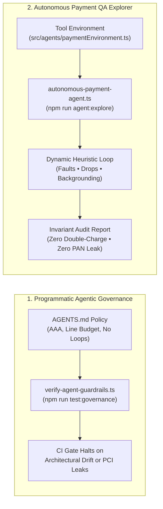
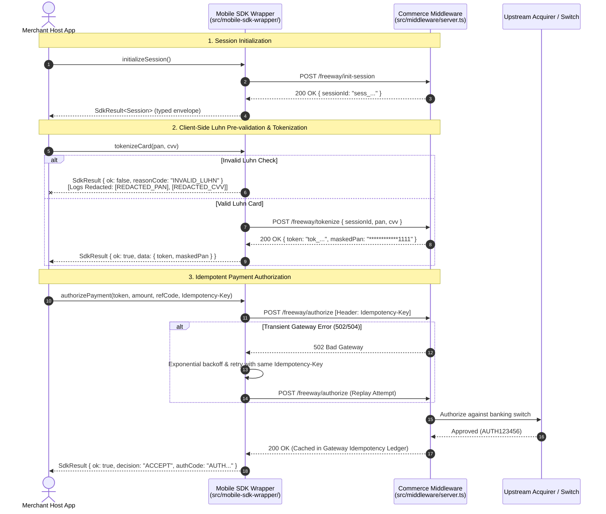
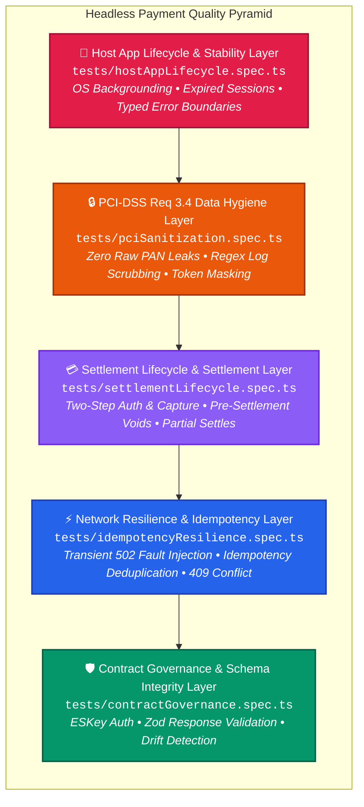

# Headless Payment SDK & Middleware QA Scenarios

[](.github/workflows/ci-gate.yml)
[](playwright.config.ts)
[](tsconfig.json)
[](package.json)
[](tests/pciSanitization.spec.ts)
[](#-agentic-quality-architecture-autonomous-exploration--governance)
[](#-educational-context--ai-provenance-disclaimer)

Reference quality architecture, test pyramid, and automated scenarios modeling a **headless mobile payment SDK wrapper** integrating with a **FreeWay-style commerce middleware gateway**.

> [!NOTE]
> ### 🌱 Educational Context & AI Provenance Disclaimer
> **This repository is a self-learning study sandbox, not a portfolio showcasing personally authored production code.**
> 
> * **Heavy AI Leverage:** This project—including its architectural designs, gateway simulation, Playwright test suites, and documentation—was created with heavy leverage of **Google Antigravity**.
> * **Intended Purpose:** The sole objective of this repository is self-education: gaining hands-on, practical familiarity with commerce middleware, headless payment SDK lifecycles, network drop-off resilience, idempotency caching, and PCI-DSS data hygiene.
> * **Transparency of Authorship:** Visitors should not assume or presume that I personally authored or independently know every technical nuance of these implementations from scratch. This project serves as an interactive learning workbench to examine and understand complex payment testing scenarios.

---

## 🎯 Executive Overview

Unlike standard web applications, a **headless mobile payment SDK** executes within third-party merchant applications without controlling the host UI or rendering its own DOM. The critical quality and reliability risks therefore center on:

1. **Flaky Network Drop-Offs & Double Billing:** Handling sudden mobile connection drops, timeouts, and `502/504` errors without charging customers twice.
2. **PCI-DSS Req 3.4 Data Hygiene:** Guaranteeing that unencrypted PANs (Primary Account Numbers) and CVVs are strictly barred from log collectors, telemetry, and error traces.
3. **SDK-to-Middleware Contract Drift:** Guarding against breaking API schema mutations between differing SDK and backend versions.
4. **Host App Stability & Lifecycle Isolation:** Safeguarding host apps from uncaught exceptions, managing OS backgrounding/foregrounding, and recovering cleanly from expired sessions.

> [!TIP]
> **Domain Architecture Reference:** For in-depth technical details on FreedomPay FreeWay™ credentials (`ESKey`), API paradigms (SOAP vs. HPC OpenAPI), the 3-state decision engine, common reason codes, and Store & Forward (SaF) continuity patterns, see the dedicated guide:  
> 📖 [**FreedomPay FreeWay™ Architectural Reference & QA Cheat Sheet**](docs/freedompay-freeway-reference.md)

---

## 🤖 Agentic Quality Architecture: Autonomous Exploration & Governance

While 95% of industry test automation relies on static, pre-written Playwright scripts executing fixed inputs against fixed assertions, this repository evolves into an **Agentic Quality Platform**:



### 1. Executable Architectural Linter (`npm run test:governance`)
Rather than treating [`AGENTS.md`](AGENTS.md) as a passive set of guidelines, the repository includes an **automated governance linter** that executes in CI to enforce:
* **PCI-DSS 3.4 Zero-Leakage:** Strictly verifies zero raw 13–16 digit PANs appear in spec files.
* **Junior Developer Readability:** Fails if any test block contains control flow logic (`if/else`, `for`, `while`, `switch`, `try/catch`). Tests must remain strictly linear.
* **Scannability Ceiling:** Enforces that every `test(...)` block remains $\le$ 35 lines.
* **Explicit AAA Comments:** Verifies explicit `// 1. Arrange`, `// 2. Act`, and `// 3. Assert` sections in every scenario.
* **Layer Isolation:** Verifies zero `expect()` assertions exist inside SDK wrappers or middleware.

### 2. Autonomous Payment Agent (`npm run agent:explore`)
Treats the payment SDK and simulated gateway as a **formal Agent Tool Environment** ([`src/agents/paymentEnvironment.ts`](src/agents/paymentEnvironment.ts)):
* **Callable Agent Tools:** `initialize_session`, `tokenize_card`, `authorize_payment`, `capture_payment`, `void_payment`, `inject_transient_502`, `background_host_app`, `audit_pci_logs`.
* **Dynamic Goal-Seeking Loop:** An autonomous agent dynamically navigates payment state transitions—injecting network chaos, testing idempotency replay deduplication, attempting payload tampering (`409 Conflict`), and verifying that PCI redaction invariants hold across the full session history.

---

## 🏗️ Architecture & Interaction Flow

The headless SDK acts as an isolated, defensive translation boundary between the merchant's application code and the commerce gateway.



---

## 📐 Test Pyramid & Risk Coverage

Instead of fragile UI-driven tests, quality verification is structured across four distinct automated layers designed for high-speed, deterministic execution.



### Risk Domain & Test Suite Matrix

| Layer | Risk Domain | Engineering Pattern & Defense | Primary Test Suite |
| :---: | :--- | :--- | :--- |
| **L4** | **Host App Lifecycle & Stability** | OS backgrounding hooks, automatic session invalidation, and typed error envelopes (`SdkResult`) preventing host crashes. | [`tests/hostAppLifecycle.spec.ts`](tests/hostAppLifecycle.spec.ts) |
| **L3** | **PCI-DSS Req 3.4 Data Hygiene** | Real-time regex sanitization across log collectors, error payloads, and strict 12-digit PAN masking (`************1111`). | [`tests/pciSanitization.spec.ts`](tests/pciSanitization.spec.ts) |
| **L3.5**| **Settlement Lifecycle (Capture & Void)**| 2-step capture settlements (`ccCaptureService`), partial captures, and pre-settlement voiding (`voidService`) with double-capture guards. | [`tests/settlementLifecycle.spec.ts`](tests/settlementLifecycle.spec.ts) |
| **L2** | **Network Drop-Offs & Double Charges** | Client retry loop with `Idempotency-Key` headers; gateway idempotency ledger returning cached authorizations and `409 Conflict` on payload tampering. | [`tests/idempotencyResilience.spec.ts`](tests/idempotencyResilience.spec.ts) |
| **L1** | **SDK-to-Middleware Contract Drift** | Runtime schema enforcement via Zod (`GatewayResponseSchema`), `ESKey` security credential validation, and granular decline mapping (`202`, `204`). | [`tests/contractGovernance.spec.ts`](tests/contractGovernance.spec.ts) |

---

## 🔍 Deep-Dive: Scenario Implementations

<details>
<summary><b>1. Network Resilience & Idempotency (tests/idempotencyResilience.spec.ts)</b></summary>

* **Fault-Tolerant Retries:** Tests inject transient `502 Bad Gateway` errors into [`PseudoPaymentMiddleware`](src/middleware/server.ts) and verify the SDK transparently retries and completes authorization within its retry budget.
* **Cached Authorization Replays:** Verifies that repeating a payment with an identical `Idempotency-Key` yields the exact same `requestId` and `authCode` without re-authorizing against the banking rails.
* **Payload Tampering Detection:** Verifies that reusing an existing `Idempotency-Key` with altered payload parameters (e.g., amount tampering) is rejected with `409 Conflict`.

```typescript
// Arrange & Act: Repeating authorization with identical Idempotency-Key
const idempotencyKey = crypto.randomUUID();
const firstAttempt = await sdk.authorizePayment(token, 7999, 'ORD-1002', idempotencyKey);
const retryAttempt = await sdk.authorizePayment(token, 7999, 'ORD-1002', idempotencyKey);

// Assert: Exactly identical response cached without duplicate transaction
expect(retryAttempt.data?.requestId).toBe(firstAttempt.data?.requestId);
expect(retryAttempt.data?.authCode).toBe(firstAttempt.data?.authCode);
```
</details>

<details>
<summary><b>2. PCI-DSS Req 3.4 Sanitization (tests/pciSanitization.spec.ts)</b></summary>

* **Zero Raw PANs in Logs:** When validation fails (such as an invalid Luhn checksum), logs collected via [`LogCollector`](tests/fixtures/paymentFixtures.ts) are scanned against `/\b(?:\d[ -]*?){13,16}\b/` to ensure full replacement with `[REDACTED_PAN]`.
* **CVV Redaction:** CVV values are replaced with `[REDACTED_CVV]` in outbound log envelopes.
* **Masked Gateway Payloads:** Ensures only truncated, masked PANs (`************1111`) are returned across tokenization and authorization responses.

```typescript
// Assert: Guarantee zero plain PAN or CVV appears in logger stream
const serializedLogs = JSON.stringify(logs.entries);
expect(serializedLogs).not.toMatch(/\b(?:\d[ -]*?){13,16}\b/);
expect(serializedLogs).toContain('[REDACTED_PAN]');
expect(serializedLogs).toContain('[REDACTED_CVV]');
```
</details>

<details>
<summary><b>3. Contract Governance & Drift Detection (tests/contractGovernance.spec.ts)</b></summary>

* **Zod Runtime Schema Contracts:** Validates every middleware endpoint response against `GatewayResponseSchema`.
* **Drift Protection:** Catches field removals, data type shifts (e.g., numeric reason codes instead of strings), and unexpected enum values before deploying to host merchants.
* **Client Request Validation:** Validates outbound authorization parameters (e.g., positive `amountCents` integer validation).

```typescript
const GatewayResponseSchema = z.object({
  requestId: z.string().uuid(),
  decision: z.enum(['ACCEPT', 'REJECT', 'ERROR']),
  reasonCode: z.string(),
  authCode: z.string().regex(/^AUTH\d{6}$/).optional(),
  maskedPan: z.string().regex(/^\*{9,12}\d{4}$/).optional(),
  gatewayVersion: z.string().regex(/^\d+\.\d+\.\d+$/),
});
```
</details>

<details>
<summary><b>4. Host App Lifecycle & Stability (tests/hostAppLifecycle.spec.ts)</b></summary>

* **OS Backgrounding Protection:** Verifies that when the host app triggers `onHostAppBackgrounded()`, active session keys are purged to prevent stale session attacks.
* **Typed Error Boundaries:** Validates that attempting transactions without an initialized session returns structured `{ ok: false, reasonCode: 'NO_ACTIVE_SESSION' }` rather than throwing uncaught JavaScript errors into the host merchant app.
* **Session Recovery:** Verifies that foregrounding the application permits clean re-initialization and successful follow-on tokenization.

```typescript
// Assert: Backgrounding safely prevents transactions without unhandled exceptions
sdk.onHostAppBackgrounded();
const result = await sdk.initializeSession();
expect(result.ok).toBe(false);
expect(result.reasonCode).toBe('SDK_BACKGROUNDED');
```
</details>

<details>
<summary><b>5. Settlement Lifecycle: Capture & Void (tests/settlementLifecycle.spec.ts)</b></summary>

* **Two-Step Settlement (Auth & Capture):** Models FreeWay's `ccCaptureService`, asserting that an authorized hold can be settled in full or partially (e.g., lodging and restaurant tab adjustments).
* **Double-Capture Guardrails:** Asserts that attempting to capture an already settled transaction is rejected with reason code `241`.
* **Pre-Settlement Voids (voidService):** Verifies that active authorizations can be voided before settlement, and that subsequent capture attempts against voided authorizations are rejected with reason code `240`.

```typescript
// Arrange & Act: Authorize and void transaction hold
const authRes = await sdk.authorizePayment(token, 8500, 'ORD-5005');
const voidRes = await sdk.voidPayment(authRes.data!.authCode!);

// Assert: Void cancels authorization hold immediately
expect(voidRes.ok).toBe(true);
expect(voidRes.decision).toBe('ACCEPT');
expect(voidRes.reasonCode).toBe('100');
```
</details>

---

## 💳 Synthetic Test Cards & Fixtures

> [!IMPORTANT]
> **PCI-DSS Compliance Rule:** Never hardcode 13–16 digit PANs in test specs. Always import synthetic card fixtures from [`tests/fixtures/paymentFixtures.ts`](tests/fixtures/paymentFixtures.ts). The CI pipeline enforces this with a static regex block.

| Constant Name | Synthetic Card Number | Expected Gateway Behavior |
| :--- | :--- | :--- |
| `TEST_CARDS.VISA_APPROVE` | `4111111111111111` | Luhn valid; Gateway generates `AUTH######` and returns `ACCEPT` (`reasonCode: 100`). |
| `TEST_CARDS.VISA_DECLINE_DO_NOT_HONOR` | `4000000000000002` | Luhn valid; Gateway triggers generic decline (`decision: REJECT`, `reasonCode: 203`). |
| `TEST_CARDS.VISA_DECLINE_INSUFFICIENT_FUNDS` | `4000000000000004` | Luhn valid; Gateway triggers insufficient funds decline (`decision: REJECT`, `reasonCode: 204`). |
| `TEST_CARDS.VISA_DECLINE_EXPIRED` | `4000000000000005` | Luhn valid; Gateway triggers expired card decline (`decision: REJECT`, `reasonCode: 202`). |
| `TEST_CARDS.INVALID_LUHN` | `4111111111111112` | Luhn check fails client-side in SDK wrapper; triggers redaction in logs (`reasonCode: INVALID_LUHN`). |
| `TEST_CARDS.DEFAULT_CVV` | `739` | Standard synthetic 3-digit CVV for tokenization workflows. |

---

## 🛠️ Developer Playbook & CLI Commands

### Prerequisites
* **Node.js**: `20.x` or `22.x+`
* **npm**: `10.x+`

### Common Workflows

```bash
# 1. Install dependencies
npm install

# 2. Run AGENTS.md Architectural Linter & Quality Governance
npm run test:governance

# 3. Run TypeScript typecheck (zero-emission contract verification)
npm run typecheck

# 4. Execute the full Playwright scenario test suite
npm test

# 5. Run the Autonomous Payment Exploration Agent (Dynamic Invariant Audit)
npm run agent:explore

# 6. Run the Full Quality Pipeline (Linter + Typecheck + Tests + Autonomous Agent)
npm run test:all
```

### Static PCI Guardrail (Pre-commit / CI)
The project includes a static scan in [.github/workflows/ci-gate.yml](.github/workflows/ci-gate.yml) that verifies no developer accidentally committed a plain-text card number to any spec file:

```bash
# Verify no 13-16 digit numbers exist in test specs
grep -rnE '\b[0-9]{13,16}\b' tests/*.spec.ts
```

---

## 📁 Repository Structure

```text
headless-payment-sdk-testing-examples/
├── .github/
│   └── workflows/
│       ├── ci-gate.yml              # GitHub Actions pipeline with static PCI grep
│       └── copilot-instructions.md  # Copilot coding rules
├── docs/
│   └── freedompay-freeway-reference.md # FreedomPay FreeWay™ architecture & reason code guide
├── scripts/
│   ├── verify-agent-guardrails.ts   # Programmatic linter enforcing AGENTS.md standards
│   └── autonomous-payment-agent.ts  # Autonomous payment QA agent with tool-calling loop
├── src/
│   ├── agents/
│   │   └── paymentEnvironment.ts    # Formal Agent Tool Environment (callable functions)
│   ├── middleware/
│   │   └── server.ts                # In-memory FreeWay gateway simulation & idempotency store
│   └── mobile-sdk-wrapper/
│       └── paymentSdkClient.ts      # Client wrapper with Luhn validation, retries & sanitization
├── tests/
│   ├── fixtures/
│   │   └── paymentFixtures.ts       # Playwright test.extend() DI fixtures & synthetic cards
│   ├── idempotencyResilience.spec.ts# 502 fault injection & replay caching tests
│   ├── pciSanitization.spec.ts      # Req 3.4 log redaction & masked PAN tests
│   ├── contractGovernance.spec.ts   # Zod schema validation & drift detection tests
│   ├── settlementLifecycle.spec.ts  # Capture & void settlement tests
│   └── hostAppLifecycle.spec.ts     # OS backgrounding & error envelope tests
├── AGENTS.md                        # AI coding agent constraints & architectural boundaries
├── playwright.config.ts             # Playwright configuration
├── tsconfig.json                    # TypeScript compiler configuration
└── package.json                     # Scripts & devDependencies
```

---

## 🛡️ Coding Guardrails & Best Practices

For contributors and AI coding assistants adding new scenarios:
1. **Fixture-Driven DI:** Never instantiate servers manually. Always inject `sdk`, `middleware`, `logs`, and `baseUrl` via `test.extend()`.
2. **No Assertions in Helpers:** Never put `expect()` inside SDK wrappers or fixtures. All assertions belong inside `*.spec.ts`.
3. **Deterministic Verification:** Arbitrary sleep calls (`setTimeout`, `page.waitForTimeout`) are strictly prohibited.
4. **See [AGENTS.md](AGENTS.md)** for full architectural constraints.
