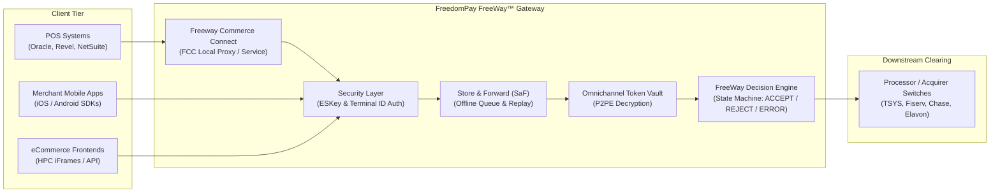

# FreedomPay FreeWay™ Architectural Reference & QA Cheat Sheet

This document compiles publicly available architectural patterns, API structures, state machines, and resilience mechanisms of the **FreedomPay FreeWay™** platform. It serves as a domain reference for designing realistic mock middleware and automated QA test scenarios in this learning sandbox.

---

## 1. Ecosystem Overview

FreedomPay's **FreeWay™** is an enterprise-grade omnichannel commerce gateway acting as the middleware bridge between:
* **Client Channels:** Mobile SDKs, Point-of-Sale (POS) terminals, and eCommerce Hosted Payment Controls (HPC).
* **Payment Processors / Banking Switches:** Downstream clearing networks such as TSYS, First Data / Fiserv, Chase Paymentech, and Elavon.

---

## 2. Authentication & Credential Hierarchy

Integrations authenticate against FreeWay via a hierarchical tenant configuration managed in the **FreedomPay Enterprise Portal** (`enterprise.freedompay.com` / `enterprise.uat.freedompay.com`):

| Credential | Purpose | Scope |
| :--- | :--- | :--- |
| **ESKey (Enhanced Security Key)** | Unique application cryptographic identifier generated per integration. Binds traffic to authorized stores and feature tiers. | Application / Integration |
| **Store ID** | Identifies the physical merchant location, legal entity, or digital store profile. | Merchant Location |
| **Terminal ID** | Identifies the individual lane, virtual register, or mobile client device instance. | Device / Session |
| **KeySlotId** | Selects the specific RSA key slot used for Point-to-Point Encryption (P2PE) payload decryption. | Hardware / Encryption |

---

## 3. Core API Paradigms & Protocols

FreedomPay supports two primary integration models:

### A. FreeWay SOAP/XML Web Services (`FreewayService.asmx`)
The classic, robust enterprise messaging protocol:
* **UAT Endpoint:** `https://cs.uat.freedompay.com/Freeway/Service.asmx`
* **Production Endpoint:** `https://cs12.freedompay.us/Freeway/Service.asmx` *(varies by cluster)*
* **Key XML Service Nodes:**
  * `<ccAuthService run="true">`: Dictates credit card authorization requests (`purchase`, `auth`, `capture`).
  * `<ccCaptureService run="true">`: Follow-up settlement capture on prior authorizations.
  * `<ccCreditService run="true">`: Refunds and credits.
  * `<voidService run="true">`: Immediate cancellation of unsettled authorizations.

### B. Hosted Payment Controls (HPC) & REST/OpenAPI
Modern RESTful endpoints providing bundled tokenization, 3D Secure / SCA, digital wallets (Apple Pay / Google Pay), and payment requests:
* **Swagger / OpenAPI Documentation:** `https://hpc.uat.freedompay.com/api/swagger/docs/v1.5`
* **UAT Base URL:** `https://hpc.uat.freedompay.com/api`
* **Workflow:** Initiated via an `InitRequest` / `InitSession` to generate ephemeral client tokens before passing control to the mobile wrapper or web iFrame.

---

## 4. The FreeWay State Machine: Decisions & Reason Codes

> [!IMPORTANT]
> **FreeWay Best Practice:** FreedomPay integration guidelines explicitly instruct client developers to branch automated control flow on the top-level **`decision`** field, rather than hardcoding complex branching solely on specific `reasonCode` values. Reason codes are primarily diagnostic.

### Primary Decision Field
* **`ACCEPT`**: Transaction approved by the downstream processor or token generated successfully.
* **`REJECT`**: Hard or soft decline by the card issuer or gateway policy (e.g., Do Not Honor, insufficient funds).
* **`ERROR`**: Malformed payload, system timeout, communication failure, or missing authentication credential.

### Common FreeWay Reason Codes

| `reasonCode` | Decision | Meaning | Realistic Test Simulation |
| :---: | :---: | :--- | :--- |
| **`100`** | `ACCEPT` | **Approved:** Transaction successfully authorized. | Standard Luhn-valid card (`TEST_CARDS.VISA_APPROVE`). |
| **`101`** | `ERROR` | **Missing Field:** One or more required fields were missing from the request payload. | Omitted `amountCents` or missing `sessionId`. |
| **`102`** | `ERROR` | **Invalid Field:** One or more fields contained malformed or out-of-spec data. | Non-numeric currency or invalid date format. |
| **`150`** | `ERROR` | **Switch Unavailable:** Downstream banking network or processor is temporarily offline. | Simulated `502 Bad Gateway` transient fault injection. |
| **`151`** | `ERROR` | **Timeout:** Gateway timed out awaiting response from banking switch. | Client-side socket timeout / dropped response. |
| **`201`** | `REJECT` | **Call Bank / Refer to Issuer:** Bank requires cardholder identity confirmation. | Card ending in specific decline mock pattern. |
| **`202`** | `REJECT` | **Expired Card:** Card expiration date is in the past. | Expired date synthetic test card. |
| **`203`** | `REJECT` | **Do Not Honor:** Generic bank decline (e.g., fraud block or bank restriction). | `TEST_CARDS.VISA_DECLINE_DO_NOT_HONOR` (`...0002`). |
| **`204`** | `REJECT` | **Insufficient Funds:** Account lacks balance to cover authorization amount. | Specific synthetic card test scenario. |
| **`205` / `206`** | `REJECT` | **Lost / Stolen Card:** Card marked stolen; do not process. | Stolen card flag test scenario. |
| **`231`** | `REJECT` | **Invalid Account Number:** PAN failed Luhn checksum or card length checks. | Malformed PAN (`TEST_CARDS.INVALID_LUHN`). |
| **`409`** | `ERROR` | **Conflict / Idempotency Violation:** Same `Idempotency-Key` presented with altered payload. | Amount or reference tampering on replay. |

---

## 5. Resilience & Offline Continuity: Store and Forward (SaF)

In brick-and-mortar or mobile point-of-sale setups, network outages are mitigated by FreedomPay's **Store and Forward (SaF)** architecture:

1. **Automatic Offline Transition:** When internet connectivity to the FreeWay gateway drops, client middleware switches into SaF offline mode.
2. **Encrypted Local Storage:** The transaction is encrypted via Point-to-Point Encryption (P2PE) and saved to a local queue. The consumer receives a pending/stored approval within defined merchant floor limits (e.g., max \$50 offline charge).
3. **Automatic Replay / Forward:** Once host connectivity is restored, the local daemon replays the queued authorizations to FreeWay sequentially.
4. **Duplicate Protection:** FreeWay uses the original transaction timestamps, `merchantReferenceCode`, and client request tokens to ensure offline replays are never double-authorized.

---

## 6. Public GitHub Repositories & Open Source Ecosystem

While internal gateway engines remain gated, the following public repositories provide community and official client patterns:

* **Official Mobile SDKs:**
  * [`freedompay-global/merchant-sdk-android`](https://github.com/freedompay-global/merchant-sdk-android) – Android 9+ merchant integration library distributed via JitPack.
  * [`freedompay-global/merchant-sdk-ios`](https://github.com/freedompay-global/merchant-sdk-ios) – iOS 15.0+ merchant toolkit distributed via Swift Package Manager.
* **Community API Wrappers:**
  * [`spazious/freedompay-client`](https://github.com/spazious/freedompay-client) – Python client generated against FreedomPay Hosted Payment Controls (HPC) OpenAPI v1.5 specification.
* **Open Source E-Commerce Plugins:**
  * FreedomPay payment modules for Magento, WooCommerce, NetSuite, and Revel Systems frequently expose public XML/REST request models in their open GitHub extensions.

---

## 7. How Our Test Sandbox Models FreedomPay

Our simulation in [`src/middleware/server.ts`](../src/middleware/server.ts) and [`src/mobile-sdk-wrapper/paymentSdkClient.ts`](../src/mobile-sdk-wrapper/paymentSdkClient.ts) specifically mirrors these FreeWay principles:

1. **FreeWay Decision State Machine:** Adheres to `{ decision: 'ACCEPT' | 'REJECT' | 'ERROR', reasonCode: string }`.
2. **Session-to-Token Flow:** Simulates `init-session` and `tokenize` decoupling card capture from payment authorization.
3. **Idempotency & Replay:** Mimics FreeWay's request hashing and duplicate rejection (`409 Conflict`).
4. **Transient Recovery:** Exercises the `150 / 502` transient failure recovery within a 2-retry exponential backoff budget.
5. **PCI-DSS Req 3.4 Hygiene:** Guarantees standard 12-digit masking (`************1111`) and zero log leakage.
